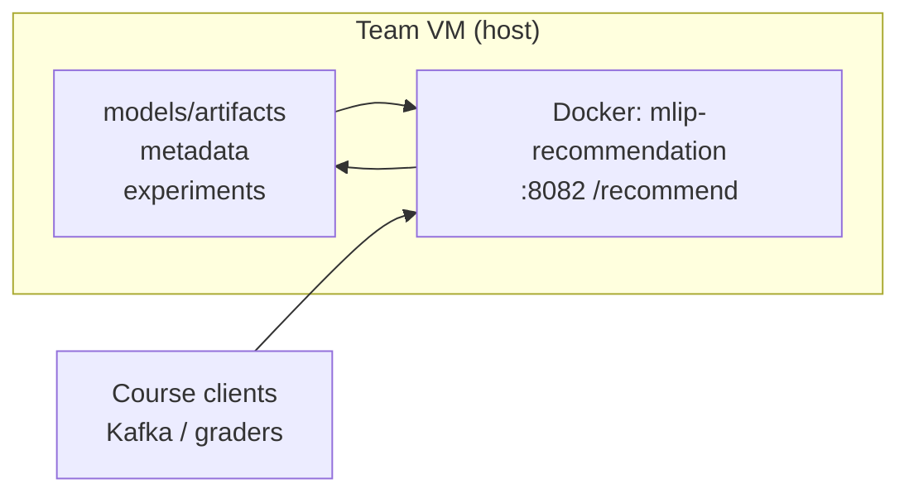

# Milestone 3 Report: Monitoring and Continuous Experimentation

**Repository:** [cmu-seai/group-project-s26-model-impossible-1](https://github.com/cmu-seai/group-project-s26-model-impossible-1)

This report matches the implementation on `main`.

---

## Containerization

We containerize **only the inference service** (Flask + gunicorn). The Prometheus/Grafana stack remains a separate Compose file under `monitoring/` (see Monitoring).

**Image:** [`Dockerfile`](https://github.com/cmu-seai/group-project-s26-model-impossible-1/blob/main/Dockerfile) — `python:3.11-slim-bookworm`, installs `requirements.txt`, copies `src/`, `metadata/`, `experiments/`, and seeded `models/artifacts/`, runs as non-root user `app`, exposes **8082**, and defines a **HEALTHCHECK** on `/health`.

**Runtime:** [`docker-compose.serving.yml`](https://github.com/cmu-seai/group-project-s26-model-impossible-1/blob/main/docker-compose.serving.yml) builds `mlip-recommendation:latest`, publishes `${REC_SERVICE_PORT:-8082}:8082`, sets `USER_API_BASE`, and **bind-mounts** (so the container sees live updates without rebuilding):
- `./models/artifacts` — joblibs, `model_version.json`, `cold_start_cache.json`
- `./metadata` (read-only) — movie/user JSON
- `./experiments` — active experiment JSON + JSONL logs

**Zero-downtime model refresh:** Retraining updates files on the host; workers reload by sending **SIGHUP** to gunicorn inside the container ([`scripts/run_rec_docker.sh reload`](https://github.com/cmu-seai/group-project-s26-model-impossible-1/blob/main/scripts/run_rec_docker.sh) or `docker kill -s HUP mlip-recommendation`). This matches the same graceful-reload pattern used for bare-metal gunicorn in [`scripts/retrain_and_deploy.sh`](https://github.com/cmu-seai/group-project-s26-model-impossible-1/blob/main/scripts/retrain_and_deploy.sh). We do **not** run two model versions behind a separate load balancer; switching versions is “new artifacts + HUP.”



**Pointers:** [`Dockerfile`](https://github.com/cmu-seai/group-project-s26-model-impossible-1/blob/main/Dockerfile) · [`docker-compose.serving.yml`](https://github.com/cmu-seai/group-project-s26-model-impossible-1/blob/main/docker-compose.serving.yml) · [`scripts/run_rec_docker.sh`](https://github.com/cmu-seai/group-project-s26-model-impossible-1/blob/main/scripts/run_rec_docker.sh)

---

## Automated Model Updates

### Retraining Pipeline

We fully automate model retraining via [`scripts/retrain_and_deploy.sh`](https://github.com/cmu-seai/group-project-s26-model-impossible-1/blob/main/scripts/retrain_and_deploy.sh), a single script that performs the complete pipeline end-to-end:

1. **Data ingestion:** Runs `src/kafka_collector.py` for 5 minutes to collect the latest events from the Kafka `movielog2` stream.
2. **Metadata refresh:** Runs `scripts/fetch_metadata.py` to fetch updated user and movie metadata from the external APIs.
3. **Model backup:** Copies current model artifacts (`model_nmf.joblib`, `model_popularity.joblib`, `cold_start.joblib`) to a timestamped backup directory for rollback.
4. **Model training:** Runs `scripts/train.py` to retrain both the NMF collaborative filtering model and the popularity model on the latest data.
5. **Provenance recording:** Writes `models/artifacts/model_version.json` with a monotonically increasing version number, training timestamp, git SHA, SHA-256 hashes of all model artifacts, and pointers to the training data files used.
6. **Offline evaluation:** Runs `scripts/offline_eval.py` as a sanity check on the new joblib artifacts produced by `scripts/train.py` (not the legacy `models/evaluate.py` / `.pkl` path).
7. **Zero-downtime deployment:** If the Docker serving container `mlip-recommendation` is running, sends **SIGHUP** to gunicorn inside it; otherwise sends `SIGHUP` to a host gunicorn process (`src.app:app`).

The script is triggered by cron every 3 days (see [`scripts/crontab.txt`](https://github.com/cmu-seai/group-project-s26-model-impossible-1/blob/main/scripts/crontab.txt)):
```
0 2 */3 * * cd $PROJECT_ROOT && bash scripts/retrain_and_deploy.sh --skip-pull >> logs/cron_retrain.log 2>&1
```

### Cold-Start Automation

New user signups are handled automatically by [`scripts/update_cold_start.py`](https://github.com/cmu-seai/group-project-s26-model-impossible-1/blob/main/scripts/update_cold_start.py). This script:

1. Monitors the Kafka stream for `create_account` events.
2. For each new user, fetches their `self_description_likes` and `self_description_dislikes` from the User API.
3. Matches mentioned movie titles against the catalog using the `title_to_id` mapping from `cold_start.joblib`.
4. Pre-computes personalized recommendations (liked movies first, then popular movies excluding disliked) and caches them in `models/artifacts/cold_start_cache.json`.

The script supports two modes:
- **Continuous (daemon):** Runs indefinitely, processing signups in real time.
- **One-shot (cron):** Runs for a configurable duration, suitable for periodic cron execution every 30 minutes.

### Implementation Pointers

- Retraining pipeline: [`scripts/retrain_and_deploy.sh`](https://github.com/cmu-seai/group-project-s26-model-impossible-1/blob/main/scripts/retrain_and_deploy.sh)
- Cold-start updater: [`scripts/update_cold_start.py`](https://github.com/cmu-seai/group-project-s26-model-impossible-1/blob/main/scripts/update_cold_start.py)
- Cron configuration: [`scripts/crontab.txt`](https://github.com/cmu-seai/group-project-s26-model-impossible-1/blob/main/scripts/crontab.txt)
- Service restart helper: [`scripts/restart_service.sh`](https://github.com/cmu-seai/group-project-s26-model-impossible-1/blob/main/scripts/restart_service.sh)

---

## Monitoring

**Dashboard screenshots (availability + accuracy + cost + drift):**


### Infrastructure Setup

We use **Prometheus** for metrics collection and **Grafana** for visualization, deployed via Docker Compose ([`monitoring/docker-compose.yml`](https://github.com/cmu-seai/group-project-s26-model-impossible-1/blob/main/monitoring/docker-compose.yml)). The monitoring stack consists of three components:

1. **Flask app instrumentation** (`src/app.py`): The recommendation service exposes a `/metrics` endpoint using `prometheus_client`. Per-request metrics include:
   - `recommendation_requests_total` — counter by HTTP status and model type (cold_start, nmf, popularity, fallback)
   - `recommendation_latency_seconds` — histogram with configurable buckets
   - `recommendation_errors_total` — counter by error type
   - `recommendations_served_total` — total individual movie IDs served
   - `recommendation_service_up` — gauge (1 = healthy)

2. **Kafka metrics exporter** (`monitoring/metrics_exporter.py`): A standalone process on port 8083 that continuously consumes the Kafka `movielog2` stream and computes:
   - `online_watch_through_rate` — WTR gauge (real-time)
   - `online_positive_rating_rate` — PRR gauge (real-time)
   - `online_license_cost_usd_total` — cumulative platform-wide license cost
   - `online_rec_attributed_cost_usd_total` — cumulative recommendation-attributed cost
   - `online_rec_rate_per_minute` — recommendation events per minute (availability proxy from Kafka)
   - `kafka_stream_consumer_connected`, `kafka_consumer_last_successful_poll_timestamp_seconds`, `kafka_consumer_reconnects_total` — Kafka consumer / tunnel health (Grafana row **Kafka stream**)
   - `drift_rating_mean`, `drift_watch_duration_mean` — rolling distribution statistics
   - `drift_rating_shift_detected`, `drift_watch_duration_shift_detected` — binary drift alerts

   **Tunnel reliability:** `scripts/ensure_kafka_tunnel.sh` uses **autossh** when installed (`scripts/install_autossh.sh`) so an SSH tunnel drop to the course broker is automatically retried; consumers in the exporter and `scripts/update_cold_start.py` reconnect after broker errors.

3. **Prometheus + Grafana** (Docker): Prometheus scrapes both endpoints every 10-15 seconds. Grafana auto-provisions a pre-built dashboard via JSON provisioning.

### What We Monitor

| Category | Metrics | Source |
|----------|---------|--------|
| **(a) Availability** | Service up/down, uptime %, request rate, rec events/min from Kafka | Flask `/metrics` + Kafka exporter |
| **(b) Model accuracy** | Watch-Through Rate, Positive-Rating Rate, model distribution pie chart | Kafka exporter |
| **(c) Operating cost** | Total license cost, rec-attributed cost, cost rate ($/min). **LLM / API token cost** is $0 in this deployment (no external LLM on the inference path); the rubric’s license-fee side is covered by the Kafka-derived counters above (see also M2 cost write-up). | Kafka exporter |
| **(d) Data drift** | Rating mean shift (>0.5), watch duration shift (>30%), drift alert indicators | Kafka exporter |

### Alerts

We configured Prometheus alerting rules in [`monitoring/alerts.yml`](https://github.com/cmu-seai/group-project-s26-model-impossible-1/blob/main/monitoring/alerts.yml):

| Alert | Condition | Severity | Rationale |
|-------|-----------|----------|-----------|
| **ServiceDown** | Service unreachable for 2 min | Critical | Availability is graded; must detect downtime immediately |
| **MetricsExporterDown** | Scrape of `:8083` fails for 3 min | Warning | Loses Kafka-side accuracy, cost, drift, and Kafka health metrics |
| **KafkaConsumerDisconnected** | `kafka_stream_consumer_connected == 0` for 3 min | Critical | Tunnel/broker/consumer failure — stream processing stopped |
| **KafkaConsumerPollStalled** | Connected but no successful poll > 180s for 3 min | Warning | Detects hung client or partial tunnel failure |
| **HighErrorRate** | Error rate > 0.1/s for 3 min | Warning | Indicates model loading or API failure |
| **HighLatency** | p95 latency > 600ms for 5 min | Warning | Service must respond within time limit |
| **NoRecommendationTraffic** | 0 rec events in Kafka for 5 min | Critical | Service may be down even if HTTP is up |
| **RatingDriftDetected** | Rating mean shifted > 0.5 for 10 min | Warning | May indicate data quality injection |
| **WatchDurationDriftDetected** | Watch duration shifted > 30% for 10 min | Warning | May indicate behavioral change or data issue |

Alerts are justified because (1) availability is directly graded (70%+ required), (2) the course explicitly states they may inject data quality issues, and (3) cost spikes could indicate anomalous behavior. The 2-minute and 5-minute `for` durations prevent false positives from brief network blips.

### Implementation Pointers

- Flask Prometheus instrumentation: [`src/app.py`](https://github.com/cmu-seai/group-project-s26-model-impossible-1/blob/main/src/app.py) (lines 23-57)
- Kafka metrics exporter: [`monitoring/metrics_exporter.py`](https://github.com/cmu-seai/group-project-s26-model-impossible-1/blob/main/monitoring/metrics_exporter.py)
- Prometheus config: [`monitoring/prometheus.yml`](https://github.com/cmu-seai/group-project-s26-model-impossible-1/blob/main/monitoring/prometheus.yml)
- Alert rules: [`monitoring/alerts.yml`](https://github.com/cmu-seai/group-project-s26-model-impossible-1/blob/main/monitoring/alerts.yml)
- Grafana dashboard: [`monitoring/grafana/dashboards/recommendation-service.json`](https://github.com/cmu-seai/group-project-s26-model-impossible-1/blob/main/monitoring/grafana/dashboards/recommendation-service.json)
- Docker Compose: [`monitoring/docker-compose.yml`](https://github.com/cmu-seai/group-project-s26-model-impossible-1/blob/main/monitoring/docker-compose.yml)
- Startup script: [`monitoring/start_monitoring.sh`](https://github.com/cmu-seai/group-project-s26-model-impossible-1/blob/main/monitoring/start_monitoring.sh)
- Grafana dashboard: http://\<vm-ip\>:3000/d/rec-service-dashboard (credentials: admin / mlip2026)

---

## Experimentation Infrastructure

**Goals:** Run two concurrent online experiments required by M3 — (1) impact of **self-descriptions** on cold-start quality, (2) **license-cost**–aware re-ranking vs. satisfaction — with deterministic assignment and analysis that reports uncertainty.

**Configuration:** Each experiment is a JSON file in [`experiments/`](https://github.com/cmu-seai/group-project-s26-model-impossible-1/tree/main/experiments): [`exp_cold_start.json`](https://github.com/cmu-seai/group-project-s26-model-impossible-1/blob/main/experiments/exp_cold_start.json) and [`exp_cost_optimise.json`](https://github.com/cmu-seai/group-project-s26-model-impossible-1/blob/main/experiments/exp_cost_optimise.json). Fields include `status: active`, variant names, and `traffic_pct` (50/50).

**User splitting:** [`src/experiment.py`](https://github.com/cmu-seai/group-project-s26-model-impossible-1/blob/main/src/experiment.py) assigns variants with a **stable hash** of `(experiment_id, user_id)` so the same user stays in the same arm for a given experiment across requests (`assign_variant`). [`ExperimentManager`](https://github.com/cmu-seai/group-project-s26-model-impossible-1/blob/main/src/experiment.py) loads all `experiments/*.json` at startup and appends one JSON line per logged assignment under `experiments/logs/<experiment_id>.jsonl` (`log_assignment`).

**Request-time routing:** [`src/app.py`](https://github.com/cmu-seai/group-project-s26-model-impossible-1/blob/main/src/app.py) applies a **composed pipeline** so `get_recommendations` runs **once** per request:
- **Stage 1 (`exp_cold_start`):** Treatment `no_cold_start` passes `effective_user_data = None`, disabling self-description–driven cold start; control keeps API `user_data`.
- **Stage 2:** Base recommendations from `get_recommendations(...)`.
- **Stage 3 (`exp_cost_optimise`):** Treatment `cost_optimised` calls `_apply_cost_rerank` from [`src/recommender_variants.py`](https://github.com/cmu-seai/group-project-s26-model-impossible-1/blob/main/src/recommender_variants.py); control leaves the list unchanged.

**Quality tracking:** Each JSONL row records `user_id`, `variant`, and the **final** top-20 list (so both experiments attribute the same outcome list). [`scripts/experiment_analysis.py`](https://github.com/cmu-seai/group-project-s26-model-impossible-1/blob/main/scripts/experiment_analysis.py) joins assignments to offline telemetry in `data/processed/watches.csv` and `data/processed/ratings.csv` and movie metadata in `metadata/movies.json`, computing per-variant **Watch-Through Rate** (watched ÷ recommended slots), **Positive-Rating Rate** (rating ≥ 4 among recommended slots with ratings), mean **rating**, and mean **license cost** per recommended movie.

**Statistical tests:** For **proportions** (WTR, PRR) we use a **two-proportion z-test** (large-sample normal approximation). For **means** (average rating, average recommendation cost) we use **Welch’s t-test** (unequal variances). Both are implemented without SciPy in `scripts/experiment_analysis.py`; unit coverage lives in [`tests/test_experiment.py`](https://github.com/cmu-seai/group-project-s26-model-impossible-1/blob/main/tests/test_experiment.py). These choices match binary/metric outcomes and avoid assuming equal variance across arms.

**Operational tools:** `GET /experiments` lists active experiments. Analysis: `python scripts/experiment_analysis.py --experiment <id>` or `--all`; results JSON is written to `experiments/results/<id>_results.json` when two variants are present.

---

## Experiment Results

### Experiment 1: Cold-start self-descriptions (`exp_cold_start`)

**What changed:** Control uses the normal path (cold start can use `self_description_likes` / `self_description_dislikes` when applicable). Treatment **`no_cold_start`** strips user profile data before recommendation so the model cannot use those self-descriptions (falls back to NMF/popularity behavior).

**How we answer the question:** Compare WTR, PRR, and mean rating between `control` and `no_cold_start` using the analysis script. A negative impact of removing self-descriptions supports that self-descriptions help cold-start quality.

**Result evidence (terminal run on VM):**


*In-repo logs are intentionally small during development; production runs should accumulate enough JSONL rows for stable z- and t-tests.*

### Experiment 2: Cost-optimised re-ranking (`exp_cost_optimise`)

**What changed:** Control uses the standard ranking. Treatment **`cost_optimised`** re-ranks the same candidate list with a **70% relevance / 30% license-cost** blend (`cost_weight: 0.3` in config).

**How we answer the question:** Compare **average recommendation license cost** (Welch’s t-test on per-movie costs) against **average rating** / PRR for recommended movies users rated — testing whether cheaper slates trade off satisfaction.

**Result evidence (terminal run on VM):**


---

## Provenance

**What we must answer for any past recommendation:** (1) **model version**, (2) **pipeline / code version** used to train it, (3) **training data** references.

### Mechanisms

1. **Training run record:** Each retrain writes [`models/artifacts/model_version.json`](https://github.com/cmu-seai/group-project-s26-model-impossible-1/blob/main/models/artifacts/model_version.json) (see [`scripts/retrain_and_deploy.sh`](https://github.com/cmu-seai/group-project-s26-model-impossible-1/blob/main/scripts/retrain_and_deploy.sh)) with:
   - `version` — integer incremented every retrain  
   - `trained_at` — UTC ISO timestamp  
   - `git_sha` / `pipeline_version` — commit of the repo used when training  
   - `training_data` — paths to `data/processed/ratings.csv`, `watches.csv`, `metadata/movies.json`, `metadata/users.json`  
   - `artifacts` — truncated SHA-256 hashes of `model_nmf.joblib`, `model_popularity.joblib`, `cold_start.joblib`  
   - `backup_dir` — timestamped directory with the previous artifacts for rollback forensics  

2. **Serving exposure:** On each scrape of `/metrics`, [`src/app.py`](https://github.com/cmu-seai/group-project-s26-model-impossible-1/blob/main/src/app.py) refreshes Prometheus **`recommendation_model` Info** metrics from `model_version.json` (`version`, `trained_at`, `git_sha`), so Grafana/Prometheus show which model bundle was live without parsing response bodies.

3. **Experiment attribution:** [`experiments/logs/<experiment_id>.jsonl`](https://github.com/cmu-seai/group-project-s26-model-impossible-1/tree/main/experiments/logs) stores, per request, `user_id`, `variant`, and the recommendation list. Together with the **Kafka** course log line (`recommendation request … result: …`), staff can align a logged recommendation with an experiment arm.

4. **Course public log:** The Kafka stream records each recommendation response and latency; that is the external ground truth for “what was served” at time *T*.

### Concrete example (illustrative)

- **Kafka line (course stream):** At some time *T*, user `70106` receives a 200 response with a comma-separated list of movie IDs (matches course format).  
- **Experiment log:** [`experiments/logs/exp_cold_start.jsonl`](https://github.com/cmu-seai/group-project-s26-model-impossible-1/blob/main/experiments/logs/exp_cold_start.jsonl) contains a row with `"user_id": "70106"`, `"variant": "control"`, and the same ordered IDs as in that response window — confirming which cold-start arm applied.  
- **Model + pipeline + data:** On the VM at *T*, open `models/artifacts/model_version.json`. Example fields: `"version": <n>`, `"git_sha": "<40-char commit>"`, `"training_data": { "ratings_csv": "data/processed/ratings.csv", ... }`, and artifact hashes. That commit in GitHub is the **pipeline / algorithm** snapshot; the CSV paths identify the **training snapshot** (plus `backup_dir` for the exact previous joblib files).

Staff can therefore: correlate Kafka → JSONL variant → `model_version.json` + git SHA + hashed joblibs.

**Pointers:** [`scripts/retrain_and_deploy.sh`](https://github.com/cmu-seai/group-project-s26-model-impossible-1/blob/main/scripts/retrain_and_deploy.sh) · [`src/app.py`](https://github.com/cmu-seai/group-project-s26-model-impossible-1/blob/main/src/app.py) (`MODEL_INFO`, `_load_model_info`) · [`src/experiment.py`](https://github.com/cmu-seai/group-project-s26-model-impossible-1/blob/main/src/experiment.py) (`log_assignment`)

---

## Team Contract Update

No update to team contract.

